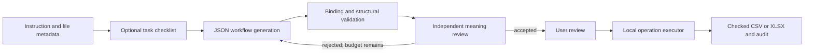

# Prompt Compiler: Schema-Aware Compilation of Natural-Language Tasks into Validated Workflows

Working report draft, 31 October 2026. This is supporting Markdown for the required IEEE report,
not a finished ten-page faculty-formatted submission. Team identities, guide details and the exact
submission template must be supplied by the owner. Measured pilot results are identified by version;
unmeasured outcomes and performance percentages are not invented.

## Abstract

Prompt Compiler translates natural-language instructions and uploaded-file metadata into a typed
workflow that can be reviewed and executed locally. The application combines a small operation
catalog, structured JSON generation, field binding, deterministic graph/column checks, an independent
model-based meaning review and bounded correction. It supports tabular filtering, boolean flags,
arithmetic, aggregation, selection, sorting, duplicate retention and calendar-day differences, with
specialized labeled-invoice extraction for documents. A versioned validation corpus separates expected
tables, appropriate clarifications and runtime guards. A frozen three-task comparison produced seven
correct results across nine strategy runs. Two failures motivated an operational Automatic policy
that omits a separate planning call but can repair rejected plans and false capability refusals.
The pilot is preliminary validation with one trial per strategy/task, not a held-out accuracy claim.

## 1. Introduction

Repeated spreadsheet work often combines selection rules, calculations, summaries and report output.
Natural language can describe these tasks compactly, but a plausible model answer does not establish
that the correct fields, boolean relationships or records were processed. A copied file can look
successful even when a requested transformation was omitted. A distinct-entity report can wrongly
collapse multiple matching source records. Structural and semantic checks therefore serve different roles.

This project investigates an inspectable compilation pipeline: the model selects operations and
arguments; local code applies the resulting plan to the actual data. The research question is whether
decomposition and bounded feedback improve workflow/output correctness over one-shot generation under
controlled settings. The engineering objective is a useful local educational tool with explicit limits,
not arbitrary-code execution or a claim to understand every document/task.

## 2. Related work

Self-Refine studies iterative model feedback and revision and motivates a bounded correction loop.
Our implementation also provides deterministic validation errors rather than relying only on critique.
Its findings must be measured again in this application's setting. [Madaan et al.](https://arxiv.org/abs/2303.17651)

ReAct connects reasoning and actions in interactive settings. Our application instead compiles a plan
before deterministic execution; it is not a reproduction of the ReAct agent loop. [Yao et al.](https://arxiv.org/abs/2210.03629)

Grammar-constrained decoding demonstrates the value of controlling output structure. Our tested
provider integration uses JSON output with local typed validation, not a custom grammar decoder.
[Geng et al.](https://arxiv.org/abs/2305.13971)

Gorilla examines accurate API selection and argument generation, motivating an explicit operation
catalog. The project does not fine-tune that model or use APIBench. [Patil et al.](https://arxiv.org/abs/2305.15334)

Work on limits of intrinsic self-correction motivates checking actual outputs against independent
references. A second model approval is useful evidence, not a ground-truth oracle.
[Huang et al.](https://arxiv.org/abs/2310.01798)

The more detailed mapping and source scope are in `docs/literature-review.md`.

## 3. Problem formulation

Let I be the user instruction, M the metadata of uploaded files, and W a typed workflow. Compilation
generates W from I and M. Structural validation checks whether W uses allowed operations and available
columns with valid dependencies. Execution E(W,D) applies W to the actual dataset D. Correctness requires
the resulting report to match the requested behavior, not merely that W parses or runs.

A plain filter preserves every matching source row, including repeated entities. A flag retains rows
and adds a nullable boolean. Aggregation and deduplication require distinct intent. Missing input values
remain explicit; invalid arithmetic, ambiguous instructions and unsupported operations have separate
outcomes. Output serialization checks verify file structure but cannot prove request adherence.

## 4. Architecture

An operational Automatic route goes directly from metadata to generation without the optional
checklist. Reviewed missing-intent questions return to the user; false unsupported claims may be
corrected. No raw table cells or document contents are sent for planning. An uploaded file remains
in session memory; explicit import settings control types and missing-value markers consistently
for preview, model metadata and execution.

Workflows use predefined operations and earlier-node dependencies. Graph checks enforce contribution
to an export and reject invalid references or output collisions. The executor uses registered code,
not generated Python, shell commands or eval. Formula-like strings are neutralized in exports.

## 5. Prompt and acceptance methodology

The operation catalog describes exact supported behavior. Prompts bind field meanings to the current
schema rather than maintaining domain-specific aliases. Nested boolean logic can be composed through
intermediate flags; only requested final fields should remain in the export. Case-insensitive text
comparisons preserve source text. Numeric conversion and missing cells are checked at execution.

The compact provider response contains title, steps and clarification. Version bookkeeping is added
locally. This reduces generation overhead compared with producing a second requirement-mapping report.
The meaning reviewer sees the original instruction, metadata and proposed plan or clarification. It
checks omitted actions, wrong fields/values/logic, unintended row reduction and output selection.

The three frozen comparison strategies are one-shot generation, planning then generation, and planning
plus bounded feedback. All use the same acceptance review, so one-shot does not mean one total API call.
An ablation without the shared reviewer remains necessary to isolate that component's effect.

## 6. Dataset and evaluation protocol

`evaluation/corpus_v1.json` contains 13 synthetic validation cases: nine expected tables, two targeted
clarifications, and two numeric runtime guards. Authored reference plans verify the executor and gold
data. They are not used as model outputs or included in model prompts. Exported reports are reopened
and compared with expected columns, row multiplicity, values and requested ordering.

The live pilot selected expense filtering, a nested flag, and grouped arithmetic. Each was attempted
once under each of the three strategies with the same corpus and implementation hashes. Model,
output mode, retry budget and reported usage are saved. Deliberate inter-request pacing respects the
provider's free-tier token window and is recorded separately from wall time.

These validation cases are not a blind held-out set. They are suitable for diagnosing this build, not
for reporting general accuracy. A final study must reserve new instruction templates before tuning,
increase task/domain coverage, repeat trials, and report service failures separately from interpretation
errors. Manual correction counts and monetary cost remain unmeasured.

## 7. Frozen pilot results

Source: `outputs/studio-release/live-comparison.json`. The report contains nine runs, 23 provider
request attempts, 45,526 reported prompt tokens and 6,759 reported completion tokens. Provider errors
can omit usage; these are reported counts, not a complete billing total.

| Strategy | Expense filter | Nested flag | Grouped arithmetic | Correct outputs |
| --- | --- | --- | --- | --- |
| Standard / one-shot + review | Pass | Rejected: helper column would leak | Pass | 2/3 |
| Plan first + review | Pass | Pass | Pass | 3/3 |
| Plan + feedback + review | Pass | False unsupported clarification | Pass | 2/3 |

The acceptance check prevented an incorrect Standard nested-flag report from being offered. The
feedback route's unsupported clarification terminated its old flow before correction. Neither outcome
should be hidden or recoded as a successful execution. This small comparison does not establish that
planning is universally superior or that feedback is ineffective.

The product's subsequent Automatic route and clarification review are a different implementation
revision. Their broader validation belongs in a separate report and must not be merged with this
frozen pilot. See the release validation notes for the final measured outcomes of that revision.

## 8. Error analysis and engineering response

The nested flag exposed two distinct failure modes: exporting internal representation columns and
mistaking a supported composition for an unsupported task. Bounded repair can address the former.
Independent review of proposed clarifications addresses the latter without automatically inventing
missing user intent. Correct clarification remains necessary for genuinely ambiguous fields or absent
thresholds. Tests distinguish those cases.

Earlier live failures also included malformed provider JSON and excessive validation bookkeeping.
The active JSON-output integration retains local validation and uses a compact response. Explicit
rate-limit handling respects Retry-After within a bounded, cancelable wait. Physical request attempts
are recorded even when a request fails. Background execution keeps the UI responsive and prevents
cancelled or obsolete results from replacing the current workspace.

## 9. Limitations and remaining work

The generator and reviewer may share biases; review is not proof. The current corpus is small and
synthetic, and the pilot lacks repeated trials. UI/browser acceptance remains with the owner. Local
reference checks, unit tests and live output checks measure different things and must be reported
separately. Pacing-adjusted wall time is not pure inference latency.

Joins, OCR, general document extraction, multi-invoice PDFs, combined multi-measure summaries and
advanced date/time operations remain unsupported. Document extraction is a labeled invoice parser.
The application is a local educational prototype rather than a hardened multi-user service.

For submission, the team must supply its details, confirm faculty dates/template, expand independent
evaluation, finalize presentation materials and format the report to the required IEEE page limit.

## 10. Conclusion

The implemented system demonstrates natural-language compilation into inspectable, locally executed
workflows. Its current evidence shows why structure, meaning review, execution and output correctness
must remain separate. The frozen pilot motivated concrete reliability changes, but broader repeated
evaluation is required before making comparative research or generalization claims.

### Subsequent Automatic validation and final local patch

The second Automatic revision passed seven table cases, failed last-occurrence deduplication after
its repair budget, and hit a service quota on the next case. Four cases remained unattempted. The
24 attempts and outcomes are preserved separately from the frozen pilot. A later local patch improves
review-summary handling and correction context; it has not been live validated because the owner
ended API testing. Local reference checks validate nine output tables and two runtime guards. These
checks do not establish natural-language accuracy. See studio-release.md for counts and limitations.
